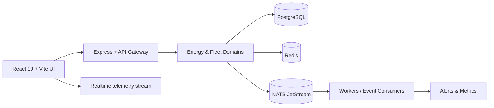
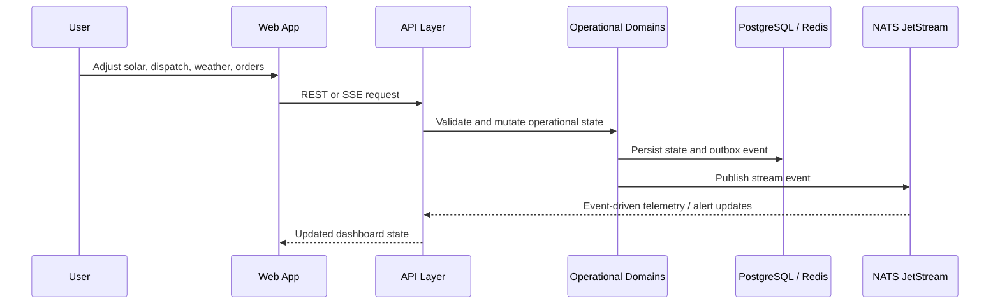

<<<<<<< HEAD
# SolarOps
=======
# SolarOps Platform

SolarOps is a modular operations platform for clean-energy microgrids and electric fleet logistics. It combines a live digital twin, dispatch intelligence, battery and solar analytics, and operational event monitoring into a single interface built for simulation, planning, and decision support.

[](LICENSE)

## Overview

This repository delivers a production-style control-room experience for:

- solar generation monitoring across multiple grid stations
- EV fleet charging, dispatch, and route planning
- battery swap operations and BESS capacity planning
- operational alerts, outbox/event auditing, and system health endpoints
- merchant order quote generation and AI-assisted fulfillment workflows

The application is designed as a modular monolith with a web interface, REST-like operational APIs, and domain-driven logic that mirrors how a real energy and logistics control center would behave.

## Architecture



### Domain model

| Domain | Responsibility | Examples |
| --- | --- | --- |
| Energy & Solar | Grid output, irradiance, BESS, station state | GS-01, GS-02, BESS-01 |
| Fleet & Charging | Dispatch, charger assignment, truck state | Truck-01 through Truck-10 |
| Logistics & Orders | Routes, delivery points, shipment quoting | DP-01 to DP-15 |
| Alerting & Monitoring | Health and operations signals | Thermal warnings, bay limits |
| Event Layer | Outbox and Event streaming | SolarGenerationUpdated, AlertResolved |

## Features

| Capability | Description |
| --- | --- |
| Live simulation dashboard | 24-hour operational timeline with weather and time scalars |
| Solar & grid operations | Station output, load balancing, buffer percent tracking |
| Fleet logistics planning | Multi-stop dispatch, route logic, charge queueing |
| Battery swap center | Pack readiness, swap operations, battery health signals |
| Merchant order intelligence | Quotes, AI negotiation flow, order pipeline tracking |
| Monitoring endpoints | Health checks, metrics, SSE telemetry, DLQ views |
| Event-driven patterns | Transactional outbox, event catalog, retry flows |

## Tech stack

| Layer | Technology |
| --- | --- |
| Frontend | React 19, TypeScript, Vite |
| Backend service | Express + Node.js |
| API surface | REST endpoints and SSE telemetry |
| Event bus | NATS JetStream |
| Database | PostgreSQL |
| Cache / locking | Redis |
| AI integration | Google Gemini API |
| Containerization | Docker and Docker Compose |

## Application flow



## Repository structure

```text
.
├── apps/
│   ├── api/                     # Python FastAPI application and domain services
│   ├── simulator/              # Simulation helpers and runtime logic
│   └── worker/                 # Background consumers and outbox workers
├── docs/
│   ├── api/                    # API references
│   ├── architecture/           # Design and system architecture notes
│   ├── database/               # Schema and data model notes
│   ├── events/                 # Event catalog and event-driven patterns
│   └── operations/             # Day-2 operational runbooks
├── infrastructure/
│   ├── docker/                 # Container definitions for app services
│   ├── monitoring/             # Telemetry and monitoring config
│   └── nats/                   # NATS settings
├── packages/
│   └── event-schemas/          # Event schema definitions
├── src/
│   ├── components/             # UI panels and modules
│   ├── data/                   # Initial state and payload definitions
│   ├── features/              # Domain modules and behaviors
│   ├── utils/                  # Physics, pricing, and modeling utilities
│   ├── App.tsx                 # UI entry point
│   ├── main.tsx                # Frontend bootstrap
│   └── types.ts                # Shared TypeScript types
├── tests/
│   └── unit/                   # Unit tests for pricing logic
├── .env.example                # Example configuration values
├── docker-compose.yml          # Local orchestration for API, web, DB, Redis, and NATS
├── Dockerfile                  # Container image for the main web application
├── LICENSE                     # MIT license
├── package.json                # Node application metadata and scripts
├── server.ts                   # Express API + Vite server entry
├── tsconfig.json               # TypeScript configuration
├── vite.config.ts             # Vite configuration
├── README.md                  # Project documentation
└── index.html                 # Application shell
```

## Prerequisites

- Node.js 20 LTS or newer
- npm 10+
- Docker Desktop or Docker Engine
- Git

## Installation

### 1. Clone the repository

```bash
git clone <your-github-repo-url>
cd solarops-platform
```

### 2. Configure environment variables

```bash
cp .env.example .env
```

Update the file as needed for your local environment. The app supports optional Gemini integration and the expected local service endpoints for PostgreSQL, Redis, and NATS.

### 3. Install dependencies

```bash
npm install --legacy-peer-deps
```

> The project uses a current React/Vite toolchain and may need legacy peer resolution in some local environments.

### 4. Run the app locally

```bash
npm run dev
```

The application will be served on:

- http://localhost:3000

### 5. Run the production build

```bash
npm run build
npm start
```

## Docker workflow

### Local services with Docker Compose

```bash
docker compose up --build
```

This starts the main web app, API service, PostgreSQL, Redis, and NATS JetStream.

### Build the application image directly

```bash
docker build -t solarops:latest .
docker run --rm -p 3000:3000 --env-file .env solarops:latest
```

## Environment variables

| Variable | Required | Purpose |
| --- | --- | --- |
| `GEMINI_API_KEY` | No | Optional Google Gemini integration for AI merchant chat |
| `PORT` | No | Application HTTP port |
| `API_URL` | No | Backend URL used by the UI |
| `DATABASE_URL` | Optional in local stacks | Postgres connection string |
| `REDIS_URL` | Optional in local stacks | Redis cache and lock configuration |
| `NATS_URL` | Optional in local stacks | NATS JetStream endpoint |
| `ENVIRONMENT` | No | Runtime environment label |

## API and runtime endpoints

The platform exposes operational endpoints for telemetry, alerts, outbox inspection, retry workflows, and metrics.

| Endpoint | Purpose |
| --- | --- |
| `/api/health` | Basic health status |
| `/api/v1/health` | Service readiness summary |
| `/api/v1/alerts` | Alert list and filtering |
| `/api/v1/outbox/events` | Event audit records |
| `/api/v1/outbox/dlq` | Dead-letter queue status |
| `/api/v1/realtime/stream` | SSE telemetry stream |
| `/metrics` | Prometheus-style metrics exposition |

## Operational contexts

The interface is tailored for five primary operational scenarios:

1. solar generation and station performance
2. fleet charging and truck dispatch execution
3. battery swap operations and stock readiness
4. commercial order negotiation and fulfillment planning
5. alert triage and event replay monitoring

## Security and configuration notes

- do not commit real API keys to source control
- keep environment-specific values in `.env` files or deployment secret stores
- use Docker Compose for local orchestration while keeping production deployment secrets outside the repository

## License

This project is released under the [MIT License](LICENSE).

## Project status

The current repository is being prepared as a polished, repo-ready platform with a structured runtime, Docker support, and GitHub-friendly documentation.
>>>>>>> 09e0c60 (Initial Project setup)
