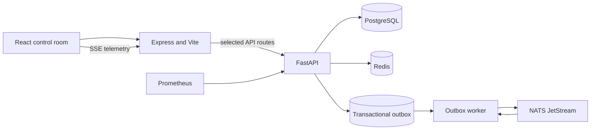

# SolarOps — Clean Energy & EV Fleet Operations

SolarOps is an interactive operations control room for a solar microgrid and an electric delivery fleet. It brings grid generation, battery storage, vehicle state, charger availability, delivery planning, pricing, alerts, and event operations together in one dashboard.

The application retains the existing chat and local simulation experience. When the infrastructure stack is enabled, supported operational APIs persist selected data in PostgreSQL, use Redis for coordination, and publish domain events through a transactional outbox to NATS JetStream. The UI can still run in simulation mode without those services.

**Repository:** [github.com/UtRaj/SolarOps](https://github.com/UtRaj/SolarOps)

## Contents

- [Capabilities](#capabilities)
- [Architecture](#architecture)
- [Technology](#technology)
- [Quick start with Docker Compose](#quick-start-with-docker-compose)
- [Run the frontend in simulation mode](#run-the-frontend-in-simulation-mode)
- [Configuration](#configuration)
- [Data and event flow](#data-and-event-flow)
- [API reference](#api-reference)
- [Tests](#tests)
- [Repository layout](#repository-layout)
- [Security and deployment notes](#security-and-deployment-notes)
- [Troubleshooting](#troubleshooting)
- [Contributing](#contributing)
- [License](#license)

## Capabilities

### Operations dashboard

- Overview of energy generation, grid stations, BESS charge, fleet status, and operations alerts.
- Solar production simulation using solar elevation, weather, temperature, tracker, soiling, and inverter efficiency factors.
- Fleet view with truck state of charge, vehicle specialization, payload capacity, charging status, and route progression.
- Battery station and charger bay views, battery pack swapping, and charging queue workflows.
- Delivery network map and multi-stop route planning.
- Transparent order pricing with distance, cargo weight, service class, optional services, and GST breakdown.
- Alerts, event history, operational details, and real-time server-sent event telemetry.
- Merchant order chat with existing local/open-source provider options and optional Gemini integration.

### Operational backend

- FastAPI v1 endpoints for energy, fleet, charging inventory, batteries, delivery points, quotes, orders, alerts, outbox events, and Redis leases.
- PostgreSQL records for supported operational domains and a transactional outbox.
- Alembic migrations with demo fleet, station, battery, charger, alert, and delivery network seed data.
- Redis-backed fixed-window request limits, token-owned distributed leases, idempotency keys, and JSON cache primitives.
- NATS JetStream publisher and durable event consumer with message deduplication, retries, and dead-letter persistence.
- Prometheus metrics for API requests, pending outbox work, and dead-letter messages.

The Compose stack persists supported API operations. Dashboard interactions that are not connected to a persisted endpoint continue to use the app's local simulation state; the README and endpoint table below distinguish the two behaviors.

## Architecture



### Services

| Service | Role | Local address |
| --- | --- | --- |
| Web | React application, Express routes, API proxy, and existing chat integration | [http://localhost:3000](http://localhost:3000) |
| FastAPI | Versioned operational API, schema validation, readiness, and metrics | [http://localhost:8000/docs](http://localhost:8000/docs) |
| PostgreSQL | Operational records, migrations, outbox, and dead-letter records | `localhost:5432` |
| Redis | Rate limits, leases, idempotency, and cache | `localhost:6379` |
| NATS JetStream | Durable event stream and worker consumer | `localhost:4222`; monitor at [http://localhost:8222](http://localhost:8222) |
| Worker | Outbox polling, event publication, and durable event consumption | Internal Compose service |
| Prometheus | Scrapes API metrics | [http://localhost:9090](http://localhost:9090) |

Ports are bound to loopback by default. PostgreSQL, Redis, and NATS use named Docker volumes; `docker compose down` keeps that data. `docker compose down -v` deletes the Compose data volumes and should only be used when a full local data reset is intended.

## Technology

- **Frontend:** React, TypeScript, Vite, Tailwind CSS, Motion, Lucide.
- **Web server:** Express with Vite middleware during development and static assets in production mode.
- **API:** Python 3.11+, FastAPI, Pydantic, SQLAlchemy async, Alembic.
- **Persistence and messaging:** PostgreSQL, Redis, NATS JetStream.
- **Observability:** Prometheus metrics endpoint and scrape configuration.
- **Packaging:** Docker Compose, Node/npm lockfile, Python requirements.

## Quick start with Docker Compose

### Requirements

- Docker Desktop (Windows/macOS) or Docker Engine with the Compose plugin.
- Git, if you are cloning the repository.

### Start the full stack

```bash
git clone https://github.com/UtRaj/SolarOps.git
cd SolarOps
cp .env.example .env
docker compose up --build -d
```

On PowerShell, copy the template with `Copy-Item .env.example .env` instead of `cp` if needed. The checked-in `.env.example` contains local development defaults. Docker Compose applies Alembic migrations before the API starts.

Confirm service health and follow logs:

```bash
docker compose ps
docker compose logs -f api worker web
```

Open the web app at [http://localhost:3000](http://localhost:3000). API documentation is at [http://localhost:8000/docs](http://localhost:8000/docs), and metrics are at [http://localhost:8000/metrics](http://localhost:8000/metrics).

Stop the stack and retain local database/event data:

```bash
docker compose down
```

To rebuild after source changes, use `docker compose up --build -d`. To inspect a failed container, use `docker compose logs <service>`.

## Run the frontend in simulation mode

Use this mode for UI development without PostgreSQL, Redis, NATS, or the FastAPI service.

Requirements: Node.js 20+ and npm.

```bash
npm ci --legacy-peer-deps
npm run dev
```

The existing Express demo handlers and in-memory UI simulations remain available when `API_URL` is unset. The AI chat keeps its existing provider configuration and is not required to start the rest of the project.

For a local production web build:

```bash
npm run build
npm start
```

## Configuration

Copy `.env.example` to `.env` for local Compose use. `.env` is ignored by Git and must not be committed. The API, worker, and web containers read the variables they need from the Compose configuration; optional chat provider credentials can be supplied through the environment.

| Variable | Purpose |
| --- | --- |
| `POSTGRES_USER`, `POSTGRES_PASSWORD`, `POSTGRES_DB` | Local database identity and credentials. The default password is only for local development. |
| `DATABASE_URL` | Async SQLAlchemy connection string used by the API and worker. Compose constructs the container URL from the Postgres variables. |
| `SYNC_DATABASE_URL` | Synchronous PostgreSQL connection string for tools that need it. |
| `REDIS_URL` | Redis connection string. Compose points this at the internal `redis` service. |
| `NATS_URL` | NATS connection string. Compose points this at the internal `nats` service. |
| `NATS_STREAM_NAME` | JetStream stream name used by the worker. |
| `NATS_SUBJECT_PREFIX` | Prefix for domain and dead-letter event subjects. |
| `GEMINI_API_KEY` | Optional Gemini credential for the existing chat provider fallback. |
| `OPEN_SOURCE_LLM_PROVIDER` | Chat provider selection: `builtin`, `ollama`, `openrouter`, `huggingface`, `groq`, or `custom`. |
| `OPEN_SOURCE_LLM_MODEL`, `OPEN_SOURCE_LLM_URL`, `OPEN_SOURCE_LLM_API_KEY` | Model name, OpenAI-compatible endpoint, and optional provider credential for chat. |

The example file also lists optional Timescale connection values for future telemetry deployments. They are not used by the current Compose stack.

## Data and event flow

### Persistence and migrations

SQLAlchemy models are in `apps/api/app/infrastructure/database/models.py`; migration history is in `apps/api/alembic/versions/`. Compose runs `alembic upgrade head` before launching FastAPI. Seed data includes the dashboard's operational fleet and network records. Database data lives in the `postgres_data` volume.

For a manual migration inside the API container:

```bash
docker compose exec api alembic -c apps/api/alembic.ini current
docker compose exec api alembic -c apps/api/alembic.ini upgrade head
```

### Transactional outbox and JetStream

API writes that produce a domain event persist the business change and the outbox row in one PostgreSQL transaction. The worker claims pending rows using `FOR UPDATE SKIP LOCKED`, publishes with `Nats-Msg-Id`, and marks rows published after JetStream acknowledges the message. Publication is at least once: event consumers should be idempotent.

Domain messages use subjects under `solarops.events.domain.*`; quarantined messages use `solarops.events.dlq`. The worker retries delivery and persists failed messages in the database dead-letter table before acknowledging the source message.

### Redis behavior

API v1 requests are limited to 60 requests per client per 60-second window, excluding liveness and readiness checks. Distributed locks use unique ownership tokens and atomic compare-and-delete release. Idempotency keys and JSON cache helpers are available to API services. Redis data is ephemeral and is not a replacement for PostgreSQL records.

## API reference

Interactive OpenAPI docs are available at `http://localhost:8000/docs`. Main API routes include:

| Method and path | Purpose |
| --- | --- |
| `GET /api/v1/health` | Liveness and service metadata. |
| `GET /api/v1/ready` | Checks PostgreSQL and Redis; responds with 503 if either dependency is unavailable. |
| `GET /api/v1/energy/grid-stations` | Reads stations and associated solar farms. |
| `GET /api/v1/energy/bess` | Reads the persisted BESS state. |
| `PUT /api/v1/energy/solar-farms/{farm_id}/scale` | Updates a farm and writes an outbox event. |
| `GET /api/v1/fleet/trucks` | Lists persisted truck status and battery state. |
| `GET /api/v1/fleet/chargers` | Lists persisted charger bays. |
| `POST /api/v1/fleet/trucks/{truck_id}/dispatch` | Validates a truck and route, stores the dispatch, and records an event. |
| `GET /api/v1/battery/packs` | Lists battery pack state. |
| `POST /api/v1/battery/swap` | Assigns a charged pack using row locking and emits an event. |
| `GET /api/v1/delivery-points` | Lists seeded delivery points. |
| `POST /api/v1/orders/quote` | Calculates a quote without persisting an order. |
| `POST /api/v1/orders` | Validates delivery points, calculates a quote, persists the order and stops, and emits an event. |
| `GET /api/v1/orders` | Lists persisted orders and stops. |
| `GET /api/v1/alerts?status=OPEN` | Lists persisted alerts, optionally filtered by status. |
| `POST /api/v1/alerts/{alert_id}/acknowledge` | Acknowledges an alert and records an event. |
| `POST /api/v1/alerts/{alert_id}/resolve` | Resolves an alert and records an event. |
| `GET /api/v1/outbox/events` | Lists recent outbox event history. |
| `GET /api/v1/outbox/stats` | Summarizes event pipeline state. |
| `GET /api/v1/outbox/dlq` | Lists quarantined messages. |
| `POST /api/v1/outbox/dlq/{dlq_id}/retry` | Re-queues a dead-letter record once. |
| `GET /api/v1/redis/stats` | Reports active leases and Redis key counts. |
| `POST /api/v1/redis/lock/acquire` and `/release` | Acquires and releases token-owned leases. |
| `GET /metrics` | Prometheus text exposition endpoint. |

The Express server proxies the supported operational routes when `API_URL` is configured. Chat endpoints and local demo routes continue to run through the existing web server.

## Tests

The suite includes TypeScript unit tests for solar output, solar time handling, distance/energy calculations, service tariffs, multi-stop pricing, truck assignment, dispatch timing, and route generation. Python tests cover FastAPI health/readiness, quote calculations, request validation, rate limiting, Redis primitives, and repository/Compose contracts.

Install JavaScript dependencies and Python requirements, then run all tests:

```bash
npm ci --legacy-peer-deps
python -m pip install -r apps/api/requirements.txt
npm test
```

Run individual suites:

```bash
npm run test:unit
python -m pytest -q tests
```

Run the static TypeScript check and production build:

```bash
npm run lint
npm run build
```

Tests are deterministic and use mocked Redis/database health dependencies; they do not require the Docker stack. The Docker Compose smoke check can be performed separately by starting the stack, checking `docker compose ps`, and requesting `/api/v1/ready`.

## Repository layout

```text
apps/api/                 FastAPI application, SQLAlchemy models, Alembic migrations
apps/simulator/           Simulation engine
apps/worker/              NATS JetStream outbox publisher and consumer
infrastructure/docker/    Web and Python container definitions
infrastructure/monitoring/Prometheus and OpenTelemetry configuration
infrastructure/nats/      NATS server configuration
packages/event-schemas/   Versioned event payload examples
src/                      React control room, API client, simulations, and chat UI
tests/api/                API contract and Redis primitive tests
tests/unit/               TypeScript business logic tests
docker-compose.yml        Local web, API, data, messaging, worker, and metrics stack
server.ts                 Express/Vite server and retained local demo handlers
```

## Security and deployment notes

- Compose binds published ports to `127.0.0.1` for local development.
- Replace the sample database password and use deployment secrets before any shared or public deployment. Never commit `.env` or provider keys.
- The current application does not implement user authentication or role-based access control. Keep it on a trusted local/development network; do not expose the API or dashboards directly to the public internet without adding and configuring access controls.
- Redis rate limiting is a basic per-client fixed window and is not a complete edge security policy.
- Configure TLS termination, secret management, backups, alerting, and resource limits as part of a real production deployment.
- The app currently mixes persisted API-backed operations with local simulation interactions; verify which data needs durable behavior before using it as a system of record.

## Troubleshooting

### A service is unhealthy

```bash
docker compose ps
docker compose logs --tail=150 api
docker compose logs --tail=150 worker
```

Check that PostgreSQL and Redis reach healthy status before the API starts. The API runs database migrations at startup; migration failures appear in API logs.

### A host port is already in use

Stop the conflicting local service or change that service's host-side port in `docker-compose.yml`. The container's internal ports should remain unchanged for service-to-service communication.

### npm reports a lockfile mismatch

Install dependencies using the documented `--legacy-peer-deps` flag. If `package.json` changes, regenerate and commit `package-lock.json` with the same npm options.

### Reset local database and broker data

`docker compose down -v` removes the named Compose volumes, including local Postgres and NATS data. This is destructive and should only be used when you explicitly want a fresh local environment.

## Contributing

1. Create a focused branch from the repository's `main` branch.
2. Keep changes compatible with existing UI and local simulation behaviors unless the feature request explicitly calls for a migration.
3. Add or update tests for changed behavior.
4. Run `npm test`, `npm run lint`, and `npm run build` for relevant changes.
5. Keep credentials, generated output, dependency directories, and runtime logs out of commits.

## License

This project is licensed under the MIT License. See [LICENSE](LICENSE).
